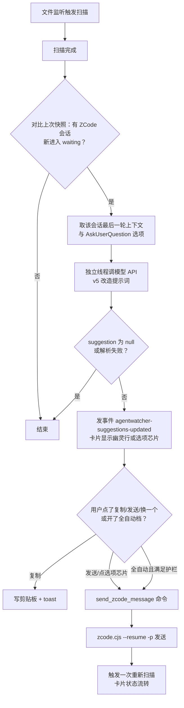

# 设计：ZCode 会话的 AI 建议回复与自动作答

用户在 2026-10-30 要求"按流程给设计、施工计划再施工"，方向（建议展示、一键与热键发送、全自动仅限选项作答并带护栏）在当天对话里逐项确认过，设计按确认过的方向落定，结论直接标 accepted；有两条执行期才能回答的问题列在文末"未决问题"。

## 要解决什么

用户同时盯多个 agent 会话。ZCode 会话停下来等人回复时，用户要切到 ZCode 窗口、读上下文、想一句回复、敲进去。这次改动让 AgentWatcher 在卡片上直接给出下一句建议，点一下送回原会话；用户不在时，对"agent 列出选项等人选"的场景自动替用户选一个。

## 背景：已经在本机验证过的事实

- ZCode 桌面版 3.16.3 自带命令行入口 `C:\Program Files\ZCode\resources\glm\zcode.cjs`（自报版本 0.17.0）。设 `ELECTRON_RUN_AS_NODE=1` 后用 `ZCode.exe` 运行它就是纯 node 进程，支持 `--resume <会话ID> -p "<文本>" --cwd <目录> --json`。
- 2026-10-30 用临时目录实测两步：headless 新建会话一次、按会话 ID 续话一次。续话返回同一个会话 ID，模型能引用第一轮的内容（用户要求回复的"PILOT OK"）。证据文件：`F:\AiProject\AgentWatcher\docs\insights\composer-predictions-report.html` 记录了当天的调查路径。
- AgentWatcher 和桌面版共用 `~/.zcode/cli/db/db.sqlite`（AGENTS.md 已载明），所以扫描拿到的会话 ID 就是命令行的会话 ID，不需要翻译。
- `ZCode.exe` 的安装路径从注册表 `HKEY_CLASSES_ROOT\zcode\shell\open\command` 反解（本机实测该键存在，指向安装目录），不在代码里写死路径。
- 提示词蓝本：ChatGPT 桌面端 Composer Predictions 的服务端提示词 v5，2026-10-29 从其配置接口实拉。它的做法是：整段对话做上下文、限定一条一行、要求点名具体动作和对象、只输出 JSON、没有可依据的下一步才允许空。

## 非目标

- 不给其他 provider 出建议。管线按 provider 无关的形状写（输入：会话上下文与待选项；输出：一条建议），本任务只接 ZCode。
- 不自动发送自由文本，任何时候都不。
- 不恢复 ZCode 点击跳转（跳转和发送是两件事，跳转另开任务）。
- 不做插件化封装。生成逻辑放宿主通用层；`ZCode.exe` 路径走注册表反解，和现有 `find_code_cli_path` 找 VS Code 同一个模式，不违反插件宿主硬规则（那条规则管的是插件，不是已装软件的系统注册项）。

## 方案对比

| 方案 | 怎么做 | 代价 | 结论 |
| --- | --- | --- | --- |
| A 宿主内置生成 + 命令行续话发送 | 扫描后对 waiting 会话调模型 API 生成建议；发送时用 `zcode.cjs --resume -p` 送回原会话 | 新增一个 HTTP 客户端依赖和一套提示词；每次建议一次 API 调用 | 选它。流程的每一段都已单独验证过，改动集中在宿主通用层 |
| B 拿 ZCode 自己当生成器 | 再起一个 headless 会话，把目标会话上下文贴进去让它产建议 | 每次建议起一个完整 agent 进程，秒级延迟；生成的会话本身又进 AgentWatcher 的扫描列表，自我污染；耗 ZCode 账号配额 | 不选 |
| C 只做发送通道，不做生成 | 卡片加"发送自定义回复"输入框，不给建议 | 省一次模型调用，但用户还得自己想那句回复，没解决主要痛点 | 不选 |
| D 什么都不做 | 维持现状：切窗口、手动回复 | 零改动；痛点还在 | 不选 |

三个执行层小决定：

| 决定 | 选项与取舍 |
| --- | --- |
| HTTP 客户端 | `ureq`（阻塞式，体积小，生成跑在独立线程，失败不拖扫描主流程）优于 `reqwest`（拖进整套异步栈）。lib.rs 全是同步代码，ureq 顺路 |
| 全局热键 | `tauri-plugin-global-shortcut`（官方插件，能力文件里声明权限）优于裸调 Win32 `RegisterHotKey`（要自己管消息循环）。仓库已接受同类官方插件 `tauri-plugin-opener` |
| 触发时机 | 进入 waiting 必触发；running 转 idle 默认不触发（每轮都建议太吵），设置里留开关 |

## 选定方案

### 数据流



### 建议生成

- 触发：Rust 侧缓存上一次扫描的会话状态表，扫描结束后对比。只有"新进入 waiting"的 ZCode 会话触发，同一个会话生成期间不重复触发；会话状态再变化（用户回复了、agent 跑起来了）则旧建议作废。
- 上下文：该会话最后 8 条消息（用户与 assistant 交替，各截 600 字）加当前工作区路径；检测到待选问题时附上问题文本与全部选项。数据从 `db.sqlite` 现读，复用扫描的只读连接方式。
- 提示词（正文里放全文，施工照抄；改造自 v5，措辞换成卡片场景）：

```text
这是一条由 AgentWatcher 应用发起的请求，用于生成给用户看的下一句建议。这不是用户本人写的消息。
建议会显示在会话卡片上，用户可以采用、修改或忽略；不会自动发送。
根据下面的对话上下文，预测这位用户接下来最可能发送的一条消息。用整个上下文理解用户当前的意图和最近一轮交流；选择最能延续这个意图的具体动作和具体对象，不要给泛泛的通用跟进；用用户自己的口吻自然表达，保留必要的约束要求；即使多个续法都说得通，也选依据最扎实的那一个；对措辞或细节不确定不是返回 null 的理由，只有上下文完全没有可依据的下一步时才返回 null。
若上下文里给了「待选问题与选项」，suggestion 必须原样使用其中一个选项的文本。
suggestion 恰好是一条自然的用户消息，一行，不超过 120 个字，或为 null。不要给备选，不要解释。
只输出符合这个格式的 JSON：{"suggestion": string|null}
```

- 输出契约：`{"suggestion": string|null}`。null、解析失败、超过 120 字一律视为"不出建议"，不报错不重试。
- 防陈旧：建议记录生成时的最后一条消息 ID。展示前和发送前各校验一次，与会话当前状态对不上就作废并按新状态重算。这对应 ChatGPT 方案里"建议锚定到具体那一轮"的做法。

### 卡片展示

- waiting 卡片在状态行下加一行置灰建议，60 字截断，行尾三个动作：复制、发送、换一个（换一个＝带一句"避开上一条"重新生成，同一条建议只允许换两次）。
- 检测到结构化待选问题时，置灰行换成选项芯片：直接把 agent 给的选项列出来，每个芯片一点即发。生成器在这类场景只回答"用户会选哪个"，不允许输出选项集之外的文本。
- 建议与选项文本只经 `agentwatcher-suggestions-updated` 事件进前端，不写 localStorage（沿用 Session Preview 的隐私规则；设置项本身照旧走 localStorage）。
- 中英文、dark/light 四象限同步。

### 发送

新增命令 `send_zcode_message({ id, text })`：

1. 从注册表反解 `ZCode.exe` 路径；没有 `zcode://` 协议注册时返回明确错误"未找到 ZCode 桌面版"。
2. `ELECTRON_RUN_AS_NODE=1` 拉起 `ZCode.exe <安装目录>\resources\glm\zcode.cjs --resume <会话ID> --cwd <工作区> -p <建议文本> --json`。子进程带 `CREATE_NO_WINDOW`（沿用 git 锚点子进程的做法），120 秒超时。
3. 成功后立刻触发一次重新扫描，让卡片状态马上从 waiting 流转出去。
4. 失败分三类报错：协议未注册；进程退出码非零（stderr 摘要进 toast）；超时。建议保留，可重试。

### 全自动档（默认关）

- 触发条件全部满足才动：设置里开了全自动；会话 waiting 且有结构化待选项；该会话连续等待超过 20 秒（用户在电脑前通常来得及自己点）。
- 动作：生成器只从选项集中挑一个，走与手点同一条发送通道。
- 护栏：
  - 每会话每小时最多 6 次自动作答；
  - 同一会话连续两次自动答案相同即熔断该会话，直到用户手动发过一条消息；
  - 每次自动作答往 `%TEMP%\AgentWatcher\auto-answers\audit.jsonl` 追加一行（时间、会话 ID、问题、选项、所选、发送结果）；
  - 预算与熔断状态只在内存，重启重置；审计文件落盘。
- 设置里一个总开关 + 每小时次数 + 等待秒数，都是简单数字，不引入策略 DSL。

### 设置

新增命令 `set_suggestion_settings`：UI 启动和改动时把设置推给后端（启用开关、模型 API 地址、密钥、模型名、热键、全自动三项）。沿用现有 `agentwatcher.settings` localStorage 键与 `agentwatcher-runtime-settings` 事件的模式。密钥存 localStorage：本工具是本地单人使用的桌面工具，现状没有凭据库，不为此引入一个。

## 边界与失败场景

| 场景 | 行为 |
| --- | --- |
| 模型 API 未配置或调用失败 | 不出建议，卡片和扫描一切照旧；设置页显示未配置提示 |
| 未装 ZCode 桌面版（注册表无 `zcode://`） | 建议照出；点发送 toast 报"未找到 ZCode 桌面版" |
| 发送超时或进程非零退出 | toast 带错误摘要；建议保留可重试 |
| 会话在建议生成后又前进了 | 旧建议作废，按新状态重算 |
| 生成器返回 null | 不展示，不报错 |
| AgentWatcher 重启 | 建议清空重算；全自动预算重置；审计文件保留 |
| 发送成功但 ZCode 桌面窗口没刷新 | 数据已落库（实测验证过），AgentWatcher 卡片会流转；桌面窗口行为见未决问题 1 |

## 影响面

改动集中在五处，其他 provider 的代码路径零接触：

| 文件 | 改动 | 规模 |
| --- | --- | --- |
| `src-tauri/src/lib.rs`（现 19889 行） | 建议管线（状态对比、上下文提取、生成、事件）、`send_zcode_message` 与 `set_suggestion_settings` 两个命令、全自动护栏、单元测试 | 约 +650 行，`AgentSession` 结构不动 |
| `ui/index.html`（现 18633 行） | 卡片幽灵行与选项芯片、设置区块、中英文词条各约 14 条、四象限样式 | 约 +380 行 |
| `src-tauri/Cargo.toml` | 新增 `ureq`、`tauri-plugin-global-shortcut` | 2 行 |
| `src-tauri/capabilities/default.json` | 热键权限 | 1 行 |
| `AGENTS.md` | ZCode 分支补"建议与发送"口径 | 约 10 行 |

复算命令：`wc -l src-tauri/src/lib.rs ui/index.html`（基线）；`grep -n "generate_handler" src-tauri/src/lib.rs`（命令注册点，现 1 处）；`grep -c "localStorage.setItem" ui/index.html`（现 6 处，新增设置写入走现有 `agentwatcher.settings`，不新增键）。

被牵连方：`scan_sessions` 的返回结构不变，建议走独立事件，所以其他 provider 的卡片渲染、CLI 的三个 pub 入口、handoff 面板都不受影响；前端对未知事件本就忽略，旧前端配新后端也不炸。

## 怎么算做对

对应 work-item 的 AC-001 到 AC-007：管线契约有单元测试（AC-001、AC-005、AC-006 的机器部分），卡片展示、真实往返、热键、设置走 `npm run test:tauri:flow -- zcode-session` 扩展步骤与人工核对清单（AC-002、AC-003、AC-004、AC-007）。

## 未决问题

1. **桌面端开着的会话被命令行续话后，桌面窗口是否实时显示新的一轮。** 空闲会话已实测数据落库；"窗口正开着"的场景只能施工后人工验证。选项：a) 桌面自动刷新，什么都不用做；b) 不刷新，卡片 toast 加一句"已送出，切到 ZCode 窗口可见"。下一步：AC-003 人工验证时记录，若是 b) 就补 toast 文案，不改架构。
2. **headless 发送要不要显式传 `--mode`。** 命令行 `--prompt` 模式默认 `yolo`（全权限）。单条纯文本回复本身不调工具，风险面在 agent 收到回复后的下一轮。选项：a) 不传，沿用会话现状；b) 自动作答时显式传 `guarded`。倾向 a（agent 的权限模式是用户在 ZCode 里自己定的，AgentWatcher 不越权改），审计里记下实际模式。下一步：施工中实测一轮确认无副作用后定案。
