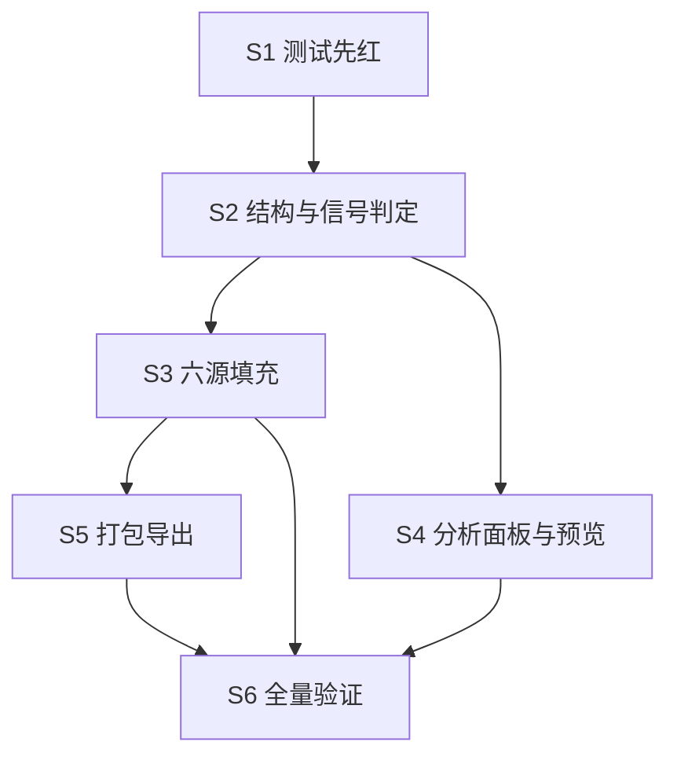

# 施工计划：逐轮降智审计器（按 design/design-v2.md）

改动集中在两个文件：`src-tauri/src/lib.rs`（结构体、六个时间轴解析器、打包导出）和 `ui/index.html`（分析面板、悬浮预览）。命令都在仓库根用 PowerShell 跑。

## 步骤

| # | 做什么 | 改哪里 | 行为变成什么样 | 怎么验证 | 完成证明 |
| --- | --- | --- | --- | --- | --- |
| S1 | 先写信号判定与分组的单元测试（先红） | `src-tauri/src/lib.rs` 文件末尾 `mod tests`：新增 `turn_audit_*` 系列测试，用手工构造的 `LifecycleCallPoint` + `turn_timestamps` 覆盖：轮窗口分组边界、模型变化（轮间不同 + 请求≠实际两种）、档位变化、低输出（低于会话中位数三成）、重试/错误/上下文超限、空 calls、degraded 透传 | 测试编译失败（`build_turn_audit` 尚不存在）即预期红灯 | `cargo test --manifest-path src-tauri/Cargo.toml turn_audit` 输出编译错误 | 编译错误贴进实现回执 |
| S2 | 核心结构与信号判定（转绿） | `src-tauri/src/lib.rs`：新增 `TurnAuditRow` 结构（camelCase 序列化，字段按设计 v2：turnIndex/tMs/modelRequested/modelServed/effortOrVariant/tokens/reasoningTokens/costUsd/ttftMs/retries/errorType/contextExceeded/signals）；`SessionLifecycle` 加 `turn_audit: Vec<TurnAuditRow>`（`skip_serializing_if` 空，旧快照不动）；新增 `build_turn_audit(calls, turn_timestamps) -> Vec<TurnAuditRow>`；`session_lifecycle`（lib.rs:3146 起）在返回前调用 | `get_session_lifecycle` 的返回多出 `turnAudit` 数组；空数据时键不出现 | `cargo test --manifest-path src-tauri/Cargo.toml turn_audit` 全绿 | 测试输出 |
| S3 | 点位扩字段 + 六源填充 | `LifecycleCallPoint`（lib.rs:188）加可空字段 `model_requested`/`effort_or_variant`/`reasoning_tokens`/`ttft_ms`/`retries`/`error_type`/`context_exceeded`（全部 `skip_serializing_if`）；六个构造点逐一填充：Claude（lib.rs:1859，`requestedModel`/`effort`/`thinking_tokens`）、Copilot Chat（lib.rs:2167，`modelId` 去前缀做请求模型、`resolvedModel` 做实际模型——先读该函数核对现状再改）、Codex（lib.rs:2589 与 `codex_thread_timeline` lib.rs:3249，`turn_context.effort`）、ZCode（lib.rs:7961，SQL 加列 `variant`/`retry_count`/`error_type`/`time_to_first_token_ms`/`reasoning_tokens`/`context_exceeded`）、OpenCode（lib.rs:8076，`data.variant`/`tokens.reasoning`/`cost`）；降采样桶（lib.rs:279）聚合规则：末值取档位/模型、求和取 retries、任一非空取 error | 各源点位带审计字段，`build_turn_audit` 消费它们；既有 timeline 快照测试（lib.rs:17064/17111 附近）不因新字段变化（None 不序列化） | `cargo test --manifest-path src-tauri/Cargo.toml` 全量（重点既有 timeline 测试） | 测试输出 |
| S4 | 分析面板：审计表 + 时间轴标记 + 分解档位 + 预览摘要行 | `ui/index.html`：分析视图（`renderAnalyticsBreakdowns` ui/index.html:14213 一带）后新增 `renderAnalyticsTurnAudit()`（可折叠表，列与 i18n 键按原型稿）；时间轴图上加模型切换竖参考线与信号点（点击滚动定位审计行，画法参照轨迹泳道已有的模型切换参考线）；按模型分解升级为「模型 × 档位」分组；悬浮预览用量区块（ui/index.html:16908 一带）后加一行摘要「模型变化链 · N 个信号」，数据懒加载 `get_session_lifecycle` 只取 `turnAudit` 摘要，不进扫描热路径、不写 localStorage；中英文 i18n 键成对补 | 分析视图多出审计表与标记；预览多一行摘要；两语言两主题正常 | `npm run test:tauri:smoke`（改的是分析面板与预览，交互面广走冒烟） | `.tmp/tauri-realtest/latest-result.json` |
| S5 | 打包导出加审计 | `src-tauri/src/lib.rs`：`export_session_package_blocking`（lib.rs:3896）里为会话计算 `turn_audit`（复用 `session_lifecycle` 同一解析路径，请求里的 id/provider 已具备）序列化为 `audit/turns.ndjson` 进 zip，并登记 manifest 的 SHA256 清单 | 右键打包的 zip 多出 `audit/turns.ndjson`，manifest 多一条目 | `cargo test --manifest-path src-tauri/Cargo.toml`；再对一个本机 Codex 会话跑一次 `npm run test:tauri:flow -- 打包` | flow 结果 + 解包核过 ndjson 首行 |
| S6 | 全量验证与记录 | 不改代码；补 `implementation.md`、`change-note.md`（骨架用 `awf record assemble` 起） | 记录齐、门禁过 | `cargo test --manifest-path src-tauri/Cargo.toml` + `node --check vscode-agentwatcher-bridge/extension.js`（桥未动应过）+ `awf record validate` | 三条命令输出 |

## 依赖关系

S4 依赖 S2 的返回结构（前端读 `turnAudit`），S5 依赖 S3 的字段填充（导出要全源数据）。S4 与 S5 改不同文件可交错，但都在本任务单线程做，不并行。

## 风险

| 风险 | 应对 |
| --- | --- |
| 既有 timeline 快照测试因结构体变化而红 | 新字段全部 `Option` + `skip_serializing_if`，序列化形状不变；红了先比对 JSON 再改聚合规则，不删断言 |
| Copilot Chat 本机无活跃文件，字段口径只有代码 fixture | S3 改到该分支时只按 `parse_copilot_chat_timeline` 现有解析字段对齐，不猜新字段；真机验证留给 AC-003 人工核对清单 |
| Codex 全文件读放大预览懒加载耗时 | 预览摘要行只在悬停时请求一次并沿用 JSONL 时序缓存（`cached_jsonl_timeline_for_path` lib.rs:1543）；实测超 300ms 再收紧 |
| 打包导出复用解析路径可能拉起 Codex app-server | 只走文件扫描路径（`codex_thread_timeline` 按 rollout 文件），不触 `thread/list`；实现时核对该函数无 app-server 依赖 |

## 回退

全部改动在 `feature/逐轮降智审计器` 分支上逐提交；任何一步翻车 `git revert` 该步提交即可，无数据迁移、无新文件格式（zip 里的 `audit/turns.ndjson` 是纯新增，旧读方忽略）。
